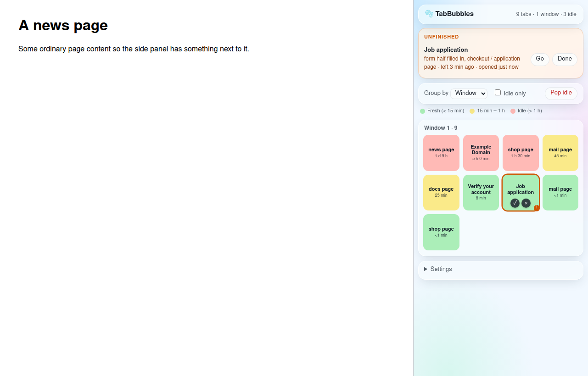
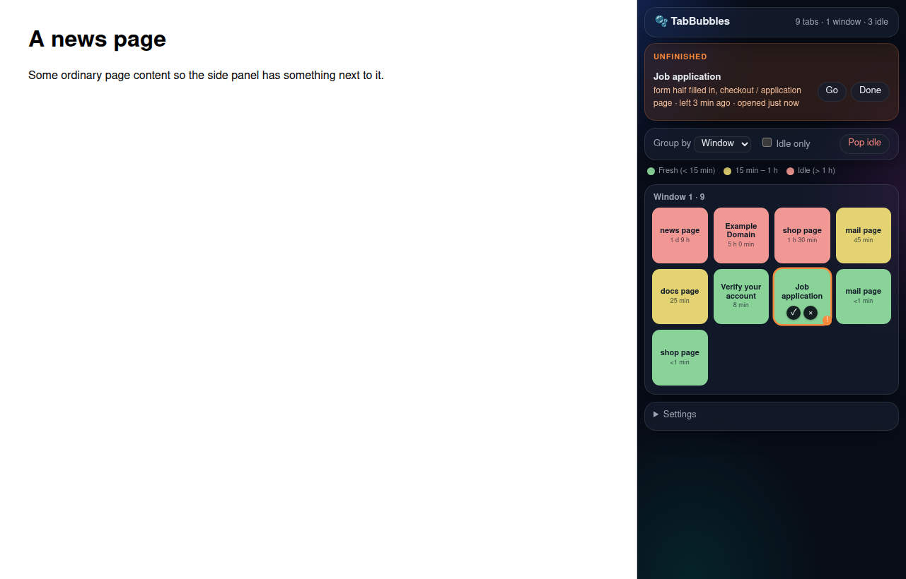

# 🫧 TabBubbles

**Too many tabs, and you forgot what you were doing in half of them.**
TabBubbles opens in the browser's side panel on the right and shows every open tab as a coloured square tile. Forgotten tabs turn from green to yellow to red. Pop the ones you don't need with one click, and get a nudge about the things you left half done: a page waiting for a verification code, a form you started, a message you typed but never sent.

> **中文简介**：浏览器里开了太多标签页，忘了自己在做什么？TabBubbles 把所有打开的标签页画成一个个泡泡：越久没看的泡泡越大、越红；点泡泡上的 × 就能把它"戳破"（关掉这个标签页）。它还会找出你做到一半的事情（等验证码的页面、填了一半的表单、打了字还没发出去的文本框、结账/申请页），提醒你"这件事还没做完，你 X 分钟前离开、X 小时前打开的"。也可以手动把一个标签页标成"待办"并写一句备注。所有数据只存在你自己的浏览器里，不上传任何内容。



<details><summary>Dark mode</summary>



</details>

Status: **MVP scaffold (v0.1.0), Chrome Manifest V3.** Loads unpacked and the side panel works (see *Testing* below). Not on the Chrome Web Store.

---

## Install (anyone, about 1 minute)

1. Download the extension:
   - **Easiest:** open [Releases](../../releases/latest), download `tabbubbles-v0.1.0.zip` and unzip it; or
   - on the repo page, click **Code → Download ZIP** and unzip it (or `git clone` it).
2. Open `chrome://extensions` (Edge: `edge://extensions`), switch on **Developer mode** (top right).
3. Click **Load unpacked** and pick the unzipped folder (the one that contains `manifest.json`).
4. Pin TabBubbles from the puzzle-piece menu and click its icon: TabBubbles opens in the side panel on the right and stays open while you browse.

Keep the folder where it is: Chrome loads the extension from it. To update, replace the folder with a newer release and click the reload ↻ button on `chrome://extensions`.

## Works in

| Browser | Status |
|---|---|
| Google Chrome 121+ | ✅ Tested (unpacked, 2026-11-04) |
| Microsoft Edge 121+ | Should work (Edge supports Chrome's side panel API), **untested** |
| Brave, Vivaldi (Chromium 121+) | Should work, **untested** |
| Arc, Opera | **Untested**; these browsers handle extension side panels differently, so the panel may not open from the icon |
| Firefox, Safari | ❌ Not supported yet |

The panel is light by default, like a normal browser page, with a frosted-glass look, and switches to a dark theme when your system is set to dark mode.

Chrome 121 is the minimum: the side panel API needs Chrome 114+ (opening it from the toolbar icon, `setPanelBehavior`, needs 116+), and TabBubbles also uses `tab.lastAccessed` (121+) to know when you last looked at each tab.

---

## Design

### Core user flows

| # | Flow | What happens |
|---|------|--------------|
| 1 | **See everything** | Click the toolbar icon → the side panel opens on the right with one square tile per tab, grouped by window (or by site). It stays open and updates live as you open, close and switch tabs. Header: `23 tabs · 3 windows · 9 idle`. |
| 2 | **Pop a tab** | Hover a bubble (or Tab to it with the keyboard): 📌 and **×** appear inside the bubble → **×** (or the Delete key) → the bubble pops and the tab closes. **Pop idle** closes every idle tab at once (after a confirm), skipping pinned tabs, tabs playing sound and unfinished tasks. |
| 3 | **Jump back** | Click a bubble → that tab and its window come to the front. |
| 4 | **Unfinished tasks** | An orange *Unfinished* panel at the top lists tabs that look half done, with what's left ("verification code waiting"), when you left it, and when you opened it. **Go** jumps there, **Done** dismisses it. |
| 5 | **Mark as task** | Hover a bubble → 📌 → type a short note ("reply to recruiter") → it joins the Unfinished list. |
| 6 | **Get reminded** | The toolbar badge shows the number of unfinished tasks you've been away from too long (orange), or else the number of idle tabs (grey). Optionally a system notification, once per task; clicking it opens the tab. |

### Bubble visualization

- **Look = equal-size square tiles** (rounded corners) in one solid light colour, with plain dark text: the first two lines of the title and how long ago you last looked.
- **Colour = 3 idle levels** (legend under the controls): **light green** fresh (< 15 min) · **light yellow** 15 min – 1 h · **light red** idle (> 1 h). Red starts at the *idle* setting (default 1 h), so it matches the badge and *Idle only*; with a different setting the levels move with it (fresh = half the idle time, at most 15 min).
- **Orange ring + "!"** = an unfinished task. Blue outline = the tab you're on now.
- **Layout**: each group is a frosted-glass card holding an even grid of tiles that fills the panel width (4 per row in a ~380 px panel). The grid is static (no floating), so nothing moves under the cursor.
- Inside: favicon, the first words of the title, and the idle time on larger bubbles. Hover for the full title, URL, last viewed and opened times.
- **Grouping**: by window (default), by site (domain), or none. Biggest groups first; inside a group, most-forgotten first.
- **Idle only** filter hides fresh tabs so you only see what needs a decision.

Later: drag tiles to reorder or move tabs between windows, and a pop sound.

### Idle detection

| Signal | Used for |
|--------|----------|
| `tab.lastAccessed` (Chrome 121+) | When you last looked at each tab. The core idle measure. |
| `chrome.tabs.onCreated` | When the tab was opened (Chrome doesn't keep this). Tabs that were already open when TabBubbles was installed show "opened ≥ X ago". |
| `chrome.tabs.onActivated` | Looking at a task tab resets its reminder. |
| `chrome.alarms` (every 1 min) | Recomputes idle tabs, due tasks and the badge. |
| `chrome.idle.queryState(120)` | No notifications while you're away from the computer or the screen is locked, so you don't come back to a pile of them. |

A tab is **idle** when it hasn't been viewed for *idle threshold* minutes (default 60, adjustable).

### "Unfinished task" heuristics

A small content script checks each page (on load, and again 1.5 s after the page changes or you type). It reports **only signal names** to the extension, never field values or page text.

| Signal | How it's detected |
|--------|------------------|
| `otp` — **verification code waiting** | An empty `<input>` with `autocomplete="one-time-code"`, or whose name / id / placeholder / label mentions otp, verification, 2FA, MFA, passcode, security code, 验证码; or a short numeric box (≤ 8 chars) on a page that talks about a code. |
| `half-form` — **form half filled in** | A form with ≥ 2 visible fields where at least one is filled and at least one (or a required one) is still empty. |
| `unsaved-text` — **text not sent yet** | A textarea with > 20 characters, or a rich-text editor you actually typed > 20 characters into. |
| `flow-page` — **checkout / application page** | URL path or title contains checkout, cart, payment, apply, application, sign-up, register, onboarding. On its own this is only a hint; it makes a tab a task only together with one of the signals above. |
| **Manual** | 📌 *Mark as task* with an optional note. Manual tasks survive a browser restart (matched back to the tab by URL). |

A task becomes **due** after you've been away from it for *remind after* minutes (default 15). Dismissing (*Done*) hides an automatic task until the page reports new signals.

### Privacy

- **Everything is local.** Settings and manual tasks live in `chrome.storage.local`; tab timing and signals live in `chrome.storage.session` (cleared when the browser closes).
- **No network requests at all.** No analytics, no server, no account.
- The content script never reads or stores what you typed; it only answers yes/no questions like "is there an empty code box?".
- The only page data shown is what Chrome's tab list already has (title, URL, favicon).

### Permissions

| Permission | Why |
|------------|-----|
| `tabs` | Read titles, URLs, favicons and `lastAccessed`; switch to and close tabs. |
| `storage` | Keep settings, notes and timing locally. |
| `alarms` | The once-a-minute check. |
| `idle` | Hold notifications while you're away. |
| `notifications` | The optional "you left this unfinished" reminder. |
| `sidePanel` | Show TabBubbles in the browser's side panel and open it from the toolbar icon. |
| host access `http://*/*`, `https://*/*` | Lets the content script look for unfinished-task signals. This is the scary-looking one in the install prompt; a later version makes it optional (see below). |

### MVP (this repo, v0.1) vs later

**In the MVP**
- Side panel with equal-size tiles coloured by idle time, grouped by window or site, idle-only filter; light + dark frosted-glass theme
- Pop one tab (×), pop all idle tabs, jump to a tab
- Automatic unfinished-task detection (code box, half form, unsent text, checkout/application page)
- Mark as task with a note; Done to dismiss
- Badge count + optional notification after N minutes, paused while you're away
- Settings: idle threshold, reminder delay, notifications on/off

**Later**
- Pop sound; drag bubbles between windows
- Make site access optional (`optional_host_permissions`): bubbles and idle tracking work without it; task detection asks per site
- Snooze a task ("remind me in 1 h"), a daily "tab cleanup" summary
- "Save & pop": keep a list of closed tabs as a reading list so closing feels safe; undo last pop
- Group by Chrome tab group; colour by tab group
- Memory use per tab (`chrome.processes` is dev-channel only; tab discarding with `chrome.tabs.discard` instead of closing)
- Detect "waiting for an email code" by matching the page's site to a verification email (opt-in, would need mail access, so not in the local-only core)
- Firefox port; Chrome Web Store listing

### Working name

**TabBubbles** (others considered: *Popcorn Tabs*, *TabPop*, *Unfinished*).

---

## Files

```
manifest.json        MV3 manifest
src/background.js    service worker: timing, tasks, badge, reminders
src/content.js       page checker: reports unfinished-task signals only
src/panel.html/.css/.js   the side panel bubble view
src/shared.js        settings defaults and helpers
icons/               toolbar icons
docs/sidepanel-*.png screenshots from the test run
site/                product page (single HTML file + images, English/中文, no external scripts)
```

## Testing

Checked on 2026-11-04 by loading the extension unpacked into Chrome 157 (headless) and driving the first (popup) version:
- a page with an empty verification-code box and a page with a half-filled application form both appeared under *Unfinished*;
- 📌 *Mark as task* with a note added a third task;
- × closed the tab and its bubble disappeared; grouping by site worked; no console errors.
- 📌 and × sit inside the bubble: on every bubble, moving the mouse from the centre to each button kept them visible, and clicking × closed only that tab without also switching to it (light and dark mode). Keyboard: Tab reaches a bubble, then its 📌 and ×; Enter works on each.

Side panel version, checked on 2026-11-04 in Chrome 157 (headless) with the extension loaded and 10 test tabs, light and dark mode (37 of 37 checks passed in each):
- the extension is set to open its side panel from the toolbar icon (`openPanelOnActionClick` reads back true, panel path `src/panel.html`), and the manifest has no popup;
- the tiles form an even grid of equal-size squares (78.5 px, 4 per row, 3 rows for 10 tabs) with no overlaps and none outside the card; no animation;
- on all 10 bubbles, moving from the centre to ✓/📌 and × kept the buttons visible and still, with the button under the cursor;
- with test tabs seeded to different idle times, all 3 colours appeared and were clearly apart in both themes;
- 📌 opened the note box, ✓ on a task cleared it, × closed exactly one tab, Tab/Enter worked for both buttons, clicking a bubble left the panel open;
- the panel added a bubble by itself when a new tab opened; grouping, Idle only, no console errors.

The screenshots show the panel page at side-panel width next to a page; headless Chrome has no toolbar, so **clicking the real toolbar icon to open the panel was not tested** (the setting behind it was).

**Not tested yet:** the badge and the notification after the 15-minute delay (needs real waiting time), behaviour after a browser restart, and very large tab counts (100+).

## License

MIT © TabBubbles contributors
